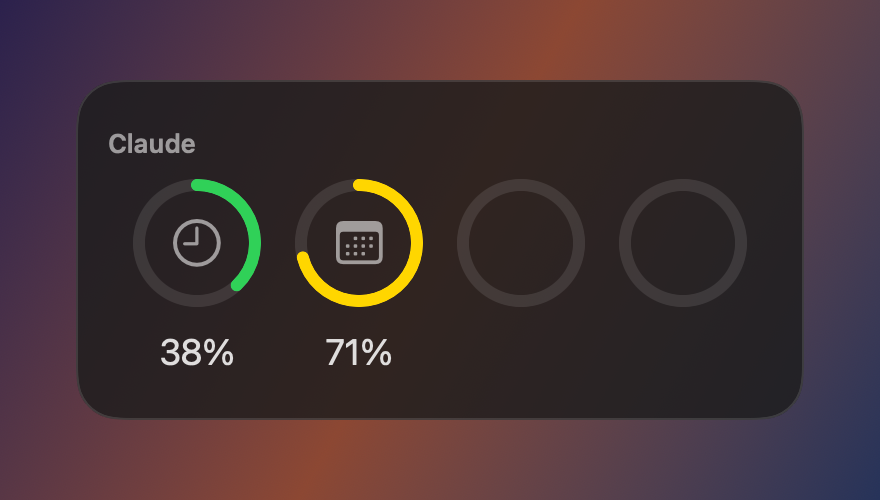
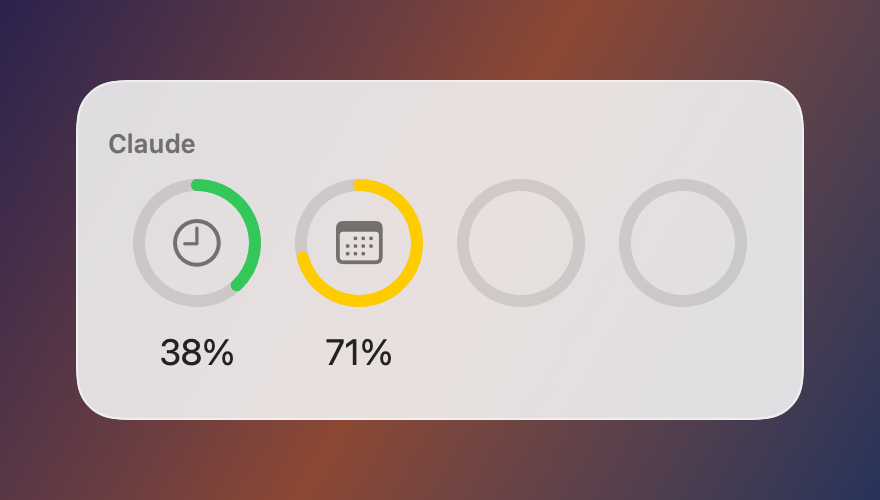
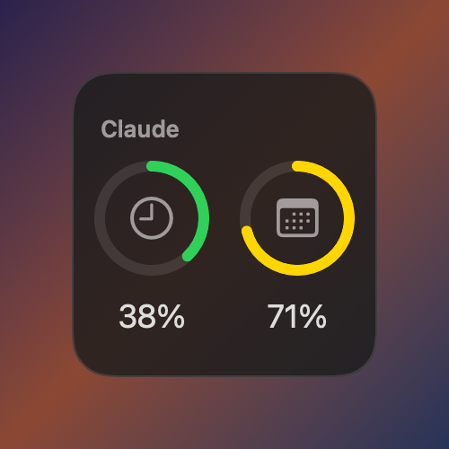
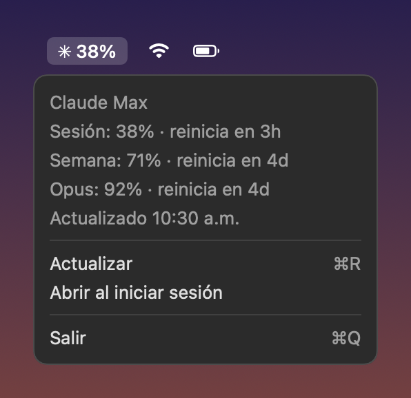
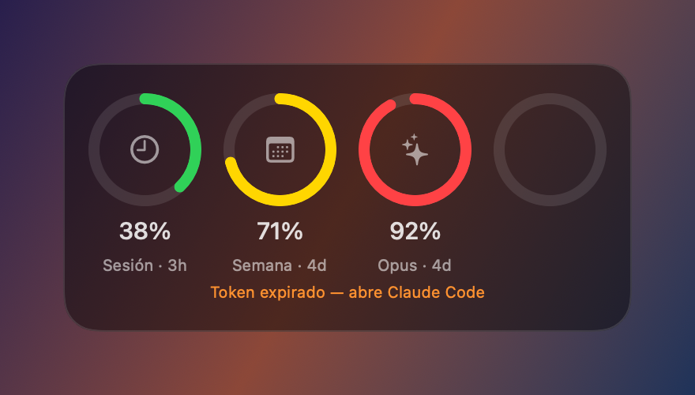

**Español** · [English](README.md)

# AI Usage

Widget de escritorio para macOS que muestra el uso de tu suscripción de Claude (sesión de 5 h, semanal y Opus/Sonnet) en anillos, al estilo del widget de Baterías. OpenAI llegará en una fase 2.

<p align="center">
  
</p>

> Las imágenes usan datos de ejemplo.

## Qué muestra

| Anillo | Significado |
|---|---|
|  **Sesión** | Límite de la ventana de 5 horas |
|  **Semana** | Límite semanal de todos los modelos |
|  **Opus / Sonnet** | Límite semanal específico del modelo (vacío si tu plan no lo tiene) |
|  | Reservado para OpenAI |

El color cambia según el uso: **verde** por debajo del 60 %, **amarillo** hasta el 85 % y **rojo** a partir de ahí. Debajo de cada anillo se indica cuánto falta para que se reinicie.

<p align="center">
  
  
</p>

Hay dos tamaños: **mediano** (4 anillos) y **pequeño** (sesión y semana). Ambos se adaptan al modo claro y al oscuro.

### Barra de menú

Una app pequeña en la barra de menú muestra el % de la sesión, actualiza los datos cada 5 minutos y alimenta el widget.

<p align="center">
  
</p>

### Avisos

Si la sesión de Claude Code caduca, o la app lleva más de 30 minutos sin actualizar, el widget mantiene los últimos datos y muestra un aviso en naranja.

<p align="center">
  
</p>

## Requisitos

- macOS 15 o posterior
- **Xcode** completo (App Store), no solo las Command Line Tools. Ábrelo una vez para aceptar la licencia.
- **XcodeGen**: `brew install xcodegen`
- **Certificado "Apple Development"**. Sirve una cuenta Apple gratuita:
  Xcode → Settings → Accounts → `+` → Apple ID → selecciona el equipo → *Manage Certificates…* → `+` → *Apple Development*.
- **Claude Code** instalado y con sesión iniciada (`claude`). El widget lee esa sesión del Keychain.

## Instalar

```sh
git clone <este repo>
cd widget-ai-usage
make install
```

Esto genera el proyecto, compila con tu certificado e instala `AIUsage.app` en `~/Applications`. Después:

1. Debe aparecer `✳︎ N%` en la barra de menú. En el menú, activa **Abrir al iniciar sesión**.
2. Clic derecho en el escritorio → **Editar widgets** → busca **AI Usage**.

`make check` comprueba solo los requisitos. Si tienes varios certificados de distintos equipos, elige uno con `make install TEAM_ID=XXXXXXXXXX`.

### Abrir la app de nuevo

Si la cierras, el widget deja de actualizarse. Para volver a abrirla: `⌘ Espacio` → **AI Usage**, o `open ~/Applications/AIUsage.app`.

### Desinstalar

1. En el menú, desactiva **Abrir al iniciar sesión** y pulsa **Salir**.
2. Quita el widget del escritorio.
3. Borra la app: `rm -rf ~/Applications/AIUsage.app`

## Cómo funciona

```
Keychain (sesión de Claude Code)
        │  cada 5 min
        ▼
AIUsage.app (barra de menú) ──► api.anthropic.com/api/oauth/usage
        │
        ▼  snapshot.json (solo %, fechas y plan)
App Group compartido
        │
        ▼
Widget (sandbox, sin red)
```

- La app de la barra de menú lee la sesión de Claude Code (`Claude Code-credentials` en el Keychain), consulta el uso y deja el resultado en un App Group compartido con el widget.
- El token solo se guarda en memoria y solo se envía a `api.anthropic.com` por HTTPS. No se escribe en disco ni en logs.
- La app **nunca renueva la sesión** (eso cerraría tu sesión de Claude Code). Si caduca, se arregla sola al volver a usar Claude Code.
- Es el mismo endpoint que usa `/usage` en Claude Code. No está documentado y podría cambiar.
